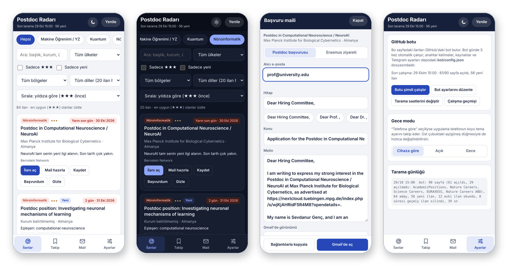

# 🔭 Postdoc Radar

**Postdoc positions in AI, quantum, neuroinformatics, bioinformatics and software testing — collected for you three times a day.** 
**Yapay zekâ, kuantum, nöroinformatik, biyoinformatik ve yazılım testi alanındaki postdoc ilanları — günde üç kez senin için toplanır.**

[English](#english) · [Türkçe](#türkçe)

---

## English

Postdoc Radar scans 12 academic job boards in Europe and North America, keeps only postdoc positions that match your research areas, rates them from ★ to ★★★ and shows them in one clean list. New matches arrive on Telegram, and an application email is one tap away.

### A quick tour

| Screen | What you can do |
|---|---|
| **Listings** | Filter by field (Machine Learning / AI, Quantum, Neuroinformatics, Bioinformatics / Health, Software Testing), country, region and programming language. Sort by deadline, by stars or by newest. Every card shows a deadline countdown, and new postings glow when they arrive. |
| **Night mode** | Follows your device's dark theme, or switch with the moon/sun button. |
| **Application email** | Pick the postdoc or Erasmus template, choose a contact found on the posting page, and open Gmail with a ready, personalised email. Your ORCID, LinkedIn, Google Scholar, GitHub and website appear as labelled links. |
| **Track** | Keep **Saved**, **Applied** and **Hidden** postings apart. These marks stay in your own browser. |
| **Settings** | See when the bot last ran, start it manually, edit its keywords and read the scan log. |

### How it works

1. **Bot.** GitHub Actions runs the scanner at 08:07, 13:07 and 19:07 (Türkiye time). It reads each posting page to find the deadline, institution, country, contact email and programming languages.
2. **Dashboard.** Results go to [`docs/jobs.json`](docs/jobs.json) and are published on [GitHub Pages](https://sevdanurgenc.github.io/CENG-Postdoc-Radar/).
3. **Alerts.** New ★★ and ★★★ positions are sent as a short Telegram digest.
4. **Phone.** The Android app uses the same code and can also scan by itself, which helps with sites that block cloud servers.

**Sources:** AcademicPositions · AcademicTransfer · Quantiki · Bernstein Network · Nature Careers (EU & US) · jobs.ac.uk · EURAXESS · CRA Career Center · AcademicJobsOnline · comp-neuro mailing list · Science Careers

**Make it yours:** keywords, sources and Telegram options live in [`bot/config.json`](bot/config.json); scan times are in [`.github/workflows/scan.yml`](.github/workflows/scan.yml). The full step-by-step setup guide (in Turkish) is in [KURULUM.md](KURULUM.md).

---

## Türkçe

Postdoc Radarı, Avrupa ve Kuzey Amerika'daki 12 akademik ilan sitesini tarar, araştırma alanlarına uyan postdoc ilanlarını seçer, ★ ile ★★★ arasında puanlar ve tek bir düzenli listede gösterir. Yeni ilanlar Telegram'a gelir, başvuru maili tek dokunuşla hazırlanır.

### Kısa bir tur

| Ekran | Neler yapabilirsin |
|---|---|
| **İlanlar** | Alana (Makine Öğrenimi / YZ, Kuantum, Nöroinformatik, Biyoinformatik / Sağlık, Yazılım Test), ülkeye, bölgeye ve programlama diline göre süz. Son tarihe, yıldıza ya da en yeniye göre sırala. Her kartta son başvuruya kalan gün görünür; yeni ilanlar geldiğinde parlar. |
| **Gece modu** | Cihazının koyu temasını takip eder ya da ay/güneş düğmesiyle değiştirirsin. |
| **Başvuru maili** | Postdoc ya da Erasmus şablonunu seç, ilan sayfasında bulunan iletişim adresini seç ve Gmail'i hazır, kişiselleştirilmiş bir mailla aç. ORCID, LinkedIn, Google Scholar, GitHub ve web sayfan etiketli bağlantılar olarak görünür. |
| **Takip** | **Kaydettiğin**, **başvurduğun** ve **gizlediğin** ilanları ayrı tut. Bu işaretler sadece kendi tarayıcında saklanır. |
| **Ayarlar** | Botun en son ne zaman çalıştığını gör, elle başlat, anahtar kelimelerini düzenle, tarama günlüğünü oku. |

### Nasıl çalışır

1. **Bot.** GitHub Actions tarayıcıyı her gün 08:07, 13:07 ve 19:07'de çalıştırır. Her ilan sayfasını okuyup son tarihi, kurumu, ülkeyi, iletişim e-postasını ve programlama dillerini bulur.
2. **Pano.** Sonuçlar [`docs/jobs.json`](docs/jobs.json) dosyasına yazılır ve [GitHub Pages](https://sevdanurgenc.github.io/CENG-Postdoc-Radar/)'te yayınlanır.
3. **Bildirim.** Yeni ★★ ve ★★★ ilanlar kısa bir Telegram özeti olarak gelir.
4. **Telefon.** Android uygulaması aynı kodu kullanır ve kendi başına da tarayabilir; bulut sunucularını engelleyen siteler için işe yarar.

**Kaynaklar:** AcademicPositions · AcademicTransfer · Quantiki · Bernstein Network · Nature Careers (Avrupa ve ABD) · jobs.ac.uk · EURAXESS · CRA Career Center · AcademicJobsOnline · comp-neuro e-posta listesi · Science Careers

**Kendine göre ayarla:** Anahtar kelimeler, kaynaklar ve Telegram ayarları [`bot/config.json`](bot/config.json) içinde; tarama saatleri [`.github/workflows/scan.yml`](.github/workflows/scan.yml) içinde. Adım adım kurulum rehberi: [KURULUM.md](KURULUM.md).

---

MIT License · Sevdanur Genç · Balıkesir University, Department of Computer Engineering

